<p align="center">
  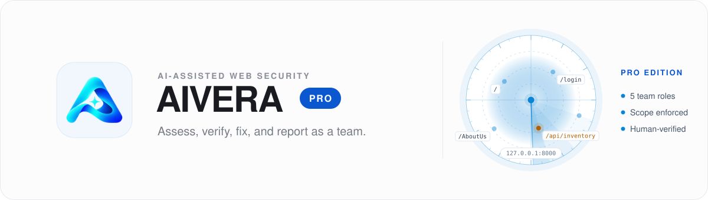
</p>

<h1 align="center">AIVERA Pro</h1>

<p align="center">The team edition of AIVERA: an intelligent web security assessment and vulnerability management app for authorized projects, evidence review, remediation, and reporting across five roles.</p>

<p align="center"><code>PRO edition</code> &nbsp; <code>Version 0.1.0</code> &nbsp; <code>React 19 + Vite 7</code> &nbsp; <code>Express + Prisma + SQLite</code> &nbsp; <code>Five team roles</code></p>

<p align="center">
  <a href="#run-locally"></a>
  <br>
  <sub>Explore the browser demo with synthetic data, or run API mode against an authorized lab target.</sub>
</p>

<p align="center">
  <a href="#at-a-glance"><strong>At a glance</strong></a> &nbsp;·&nbsp;
  <a href="#app-tour"><strong>App tour</strong></a> &nbsp;·&nbsp;
  <a href="#roles"><strong>Roles</strong></a> &nbsp;·&nbsp;
  <a href="#how-it-works"><strong>How it works</strong></a> &nbsp;·&nbsp;
  <a href="#run-locally"><strong>Run locally</strong></a> &nbsp;·&nbsp;
  <a href="#explore-the-repository"><strong>Explore the repository</strong></a>
</p>

<p align="center"><sub><strong>PRO</strong> · team roles, remediation, retests, and approvals &nbsp;|&nbsp; Need a single-user scanner? See <a href="https://github.com/Feliciety02/AIVERA-lite"><strong>AIVERA Lite</strong></a></sub></p>

The browser demo uses synthetic data. API mode stores projects and findings in SQLite, enforces role and scope checks, and can run explicitly enabled assessments on an authorized lab target. AI assists with interpretation; a person confirms or rejects each finding.

## At a glance

<table>
  <tr>
    <td align="center" width="25%"><strong>01 · Scope</strong><br><sub>Projects, authorized targets, boundaries</sub></td>
    <td align="center" width="25%"><strong>02 · Assess</strong><br><sub>Recon, scans, checklists, tool output</sub></td>
    <td align="center" width="25%"><strong>03 · Verify</strong><br><sub>Evidence, human decisions, risk</sub></td>
    <td align="center" width="25%"><strong>04 · Resolve</strong><br><sub>Fixes, retests, approvals, reports</sub></td>
  </tr>
</table>

## App tour

These **80 unedited 1440 × 900 screenshots** show the public pages and the main menu screens for all five demo roles, captured in Microsoft Edge on **November 16, 2026**. They use **browser demo, synthetic data**; empty states reflect the seeded demo data. Select an image to open it at full size. The [capture archive](docs/screenshots/role-tour-2026-11-16/README.md) lists routes, capture details, and file hashes.

### Public pages

Visitors can explore AIVERA and reach the account entry points.

<table>
  <tr>
    <td align="center" width="50%"><a href="docs/screenshots/role-tour-2026-11-16/public-01-landing-page.png">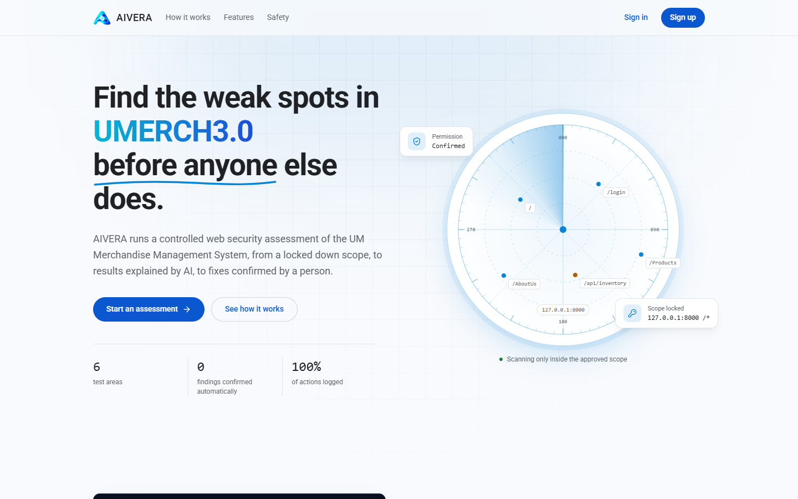</a><br><strong>1 · Landing page</strong><br><sub>Platform introduction</sub></td>
    <td align="center" width="50%"><a href="docs/screenshots/role-tour-2026-11-16/public-02-sign-in.png">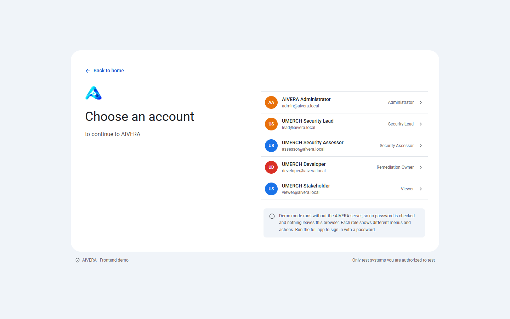</a><br><strong>2 · Sign in</strong><br><sub>Account access</sub></td>
  </tr>
  <tr>
    <td align="center" width="50%"><a href="docs/screenshots/role-tour-2026-11-16/public-03-create-account.png">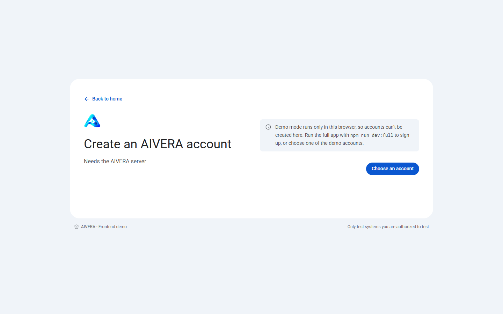</a><br><strong>3 · Create account</strong><br><sub>New account request</sub></td>
  </tr>
</table>

### Administrator

Administrators oversee access, projects, assessments, settings, and reports.

<table>
  <tr>
    <td align="center" width="50%"><a href="docs/screenshots/role-tour-2026-11-16/administrator-01-dashboard.png"></a><br><strong>1 · Dashboard</strong><br><sub>Platform overview</sub></td>
    <td align="center" width="50%"><a href="docs/screenshots/role-tour-2026-11-16/administrator-02-my-work.png">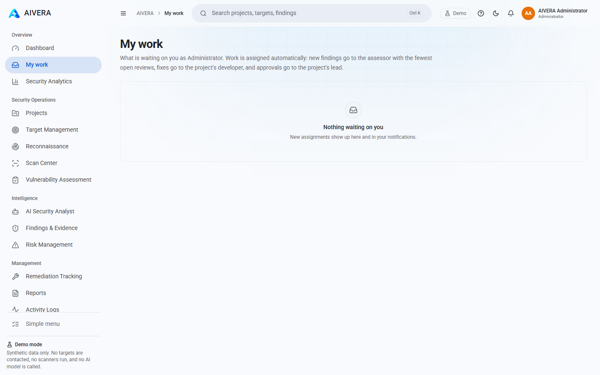</a><br><strong>2 · My work</strong><br><sub>Work and activity overview</sub></td>
  </tr>
  <tr>
    <td align="center" width="50%"><a href="docs/screenshots/role-tour-2026-11-16/administrator-03-security-analytics.png">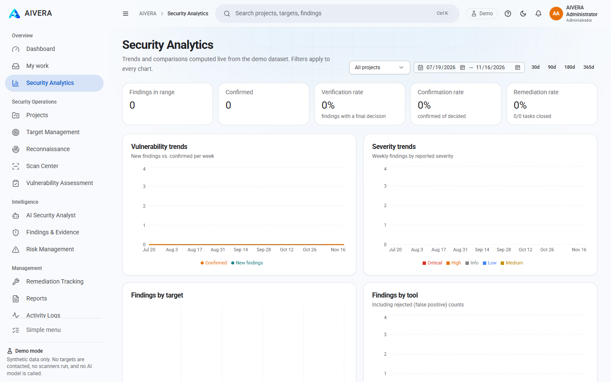</a><br><strong>3 · Security Analytics</strong><br><sub>Assessment trends and metrics</sub></td>
    <td align="center" width="50%"><a href="docs/screenshots/role-tour-2026-11-16/administrator-04-projects.png">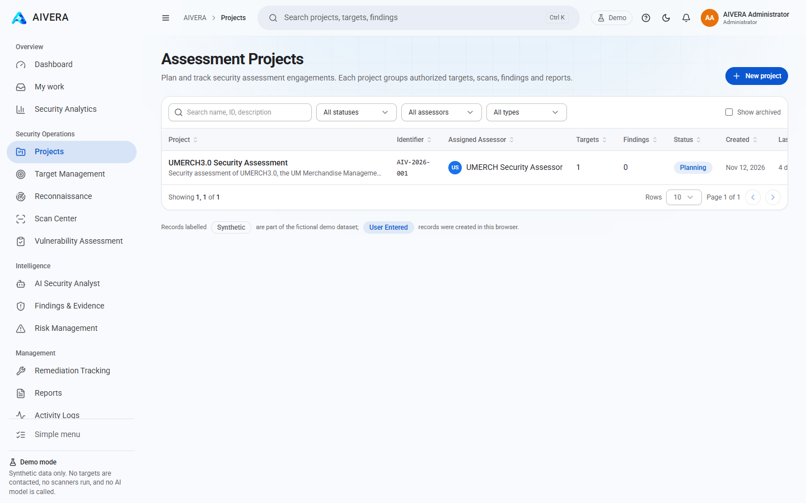</a><br><strong>4 · Projects</strong><br><sub>Assessment projects</sub></td>
  </tr>
  <tr>
    <td align="center" width="50%"><a href="docs/screenshots/role-tour-2026-11-16/administrator-05-target-management.png">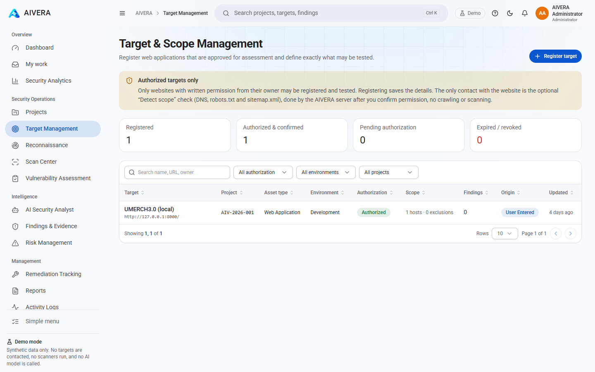</a><br><strong>5 · Target Management</strong><br><sub>Authorized targets and scope</sub></td>
    <td align="center" width="50%"><a href="docs/screenshots/role-tour-2026-11-16/administrator-06-reconnaissance.png"></a><br><strong>6 · Reconnaissance</strong><br><sub>Hosts, services, and endpoints</sub></td>
  </tr>
  <tr>
    <td align="center" width="50%"><a href="docs/screenshots/role-tour-2026-11-16/administrator-07-scan-center.png"></a><br><strong>7 · Scan Center</strong><br><sub>Scan status and history</sub></td>
    <td align="center" width="50%"><a href="docs/screenshots/role-tour-2026-11-16/administrator-08-vulnerability-assessment.png">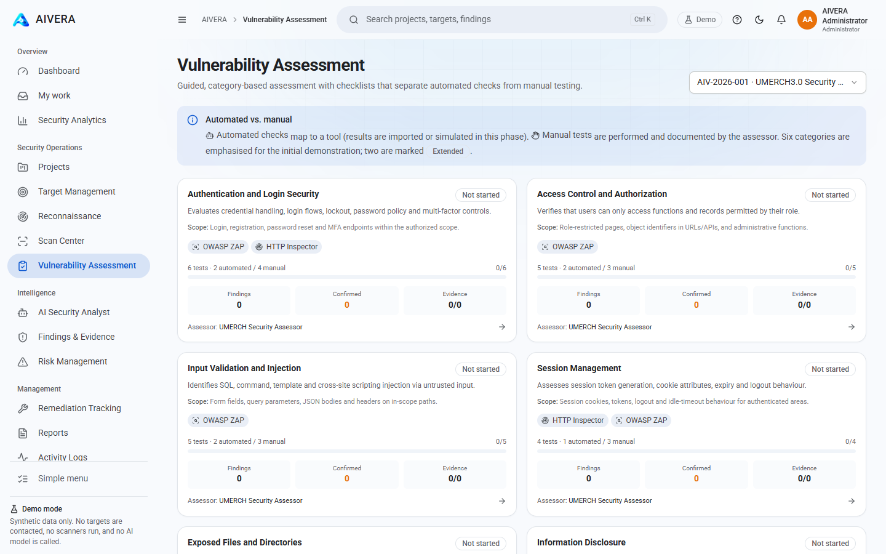</a><br><strong>8 · Vulnerability Assessment</strong><br><sub>Guided security checks</sub></td>
  </tr>
  <tr>
    <td align="center" width="50%"><a href="docs/screenshots/role-tour-2026-11-16/administrator-09-ai-security-analyst.png"></a><br><strong>9 · AI Security Analyst</strong><br><sub>AI-assisted evidence review</sub></td>
    <td align="center" width="50%"><a href="docs/screenshots/role-tour-2026-11-16/administrator-10-findings-evidence.png"></a><br><strong>10 · Findings &amp; Evidence</strong><br><sub>Findings and supporting proof</sub></td>
  </tr>
  <tr>
    <td align="center" width="50%"><a href="docs/screenshots/role-tour-2026-11-16/administrator-11-risk-management.png">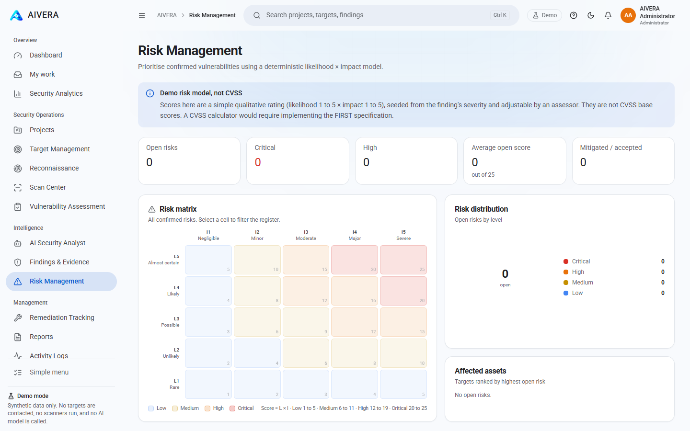</a><br><strong>11 · Risk Management</strong><br><sub>Risk register and priorities</sub></td>
    <td align="center" width="50%"><a href="docs/screenshots/role-tour-2026-11-16/administrator-12-remediation-tracking.png">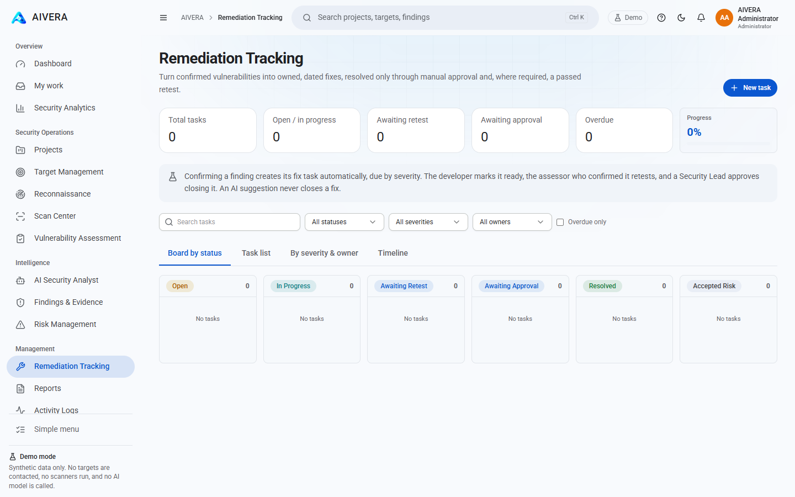</a><br><strong>12 · Remediation Tracking</strong><br><sub>Fixes and retest progress</sub></td>
  </tr>
  <tr>
    <td align="center" width="50%"><a href="docs/screenshots/role-tour-2026-11-16/administrator-13-reports.png">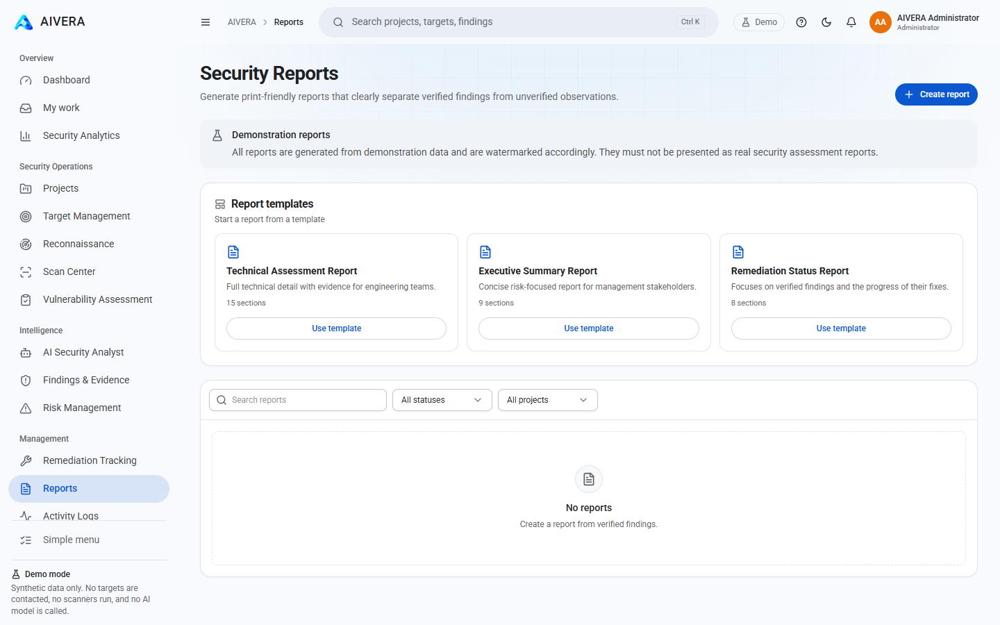</a><br><strong>13 · Reports</strong><br><sub>Assessment reports</sub></td>
    <td align="center" width="50%"><a href="docs/screenshots/role-tour-2026-11-16/administrator-14-activity-logs.png">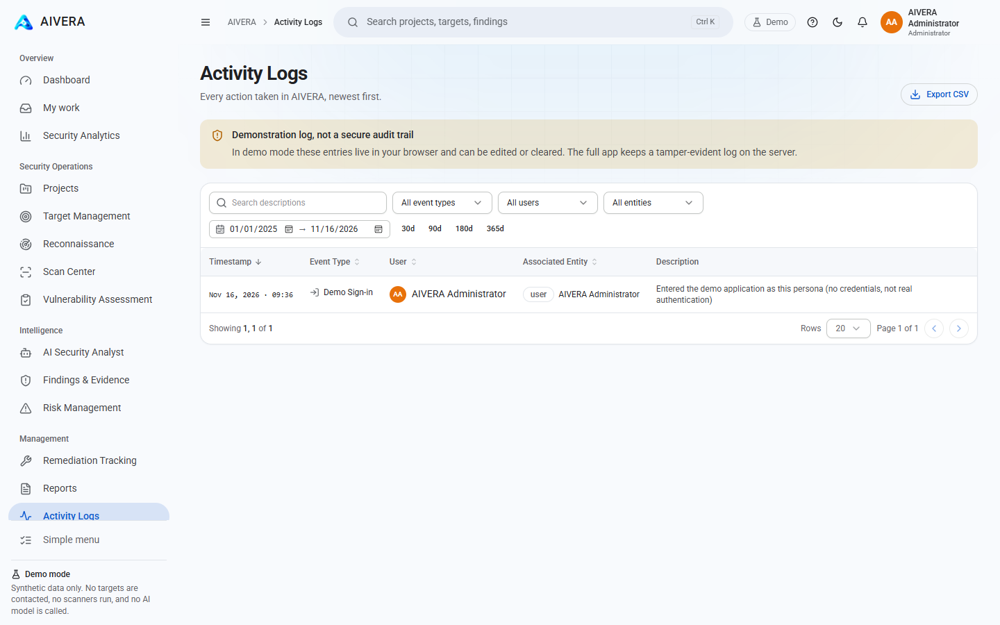</a><br><strong>14 · Activity Logs</strong><br><sub>Recorded activity</sub></td>
  </tr>
  <tr>
    <td align="center" width="50%"><a href="docs/screenshots/role-tour-2026-11-16/administrator-15-user-management.png">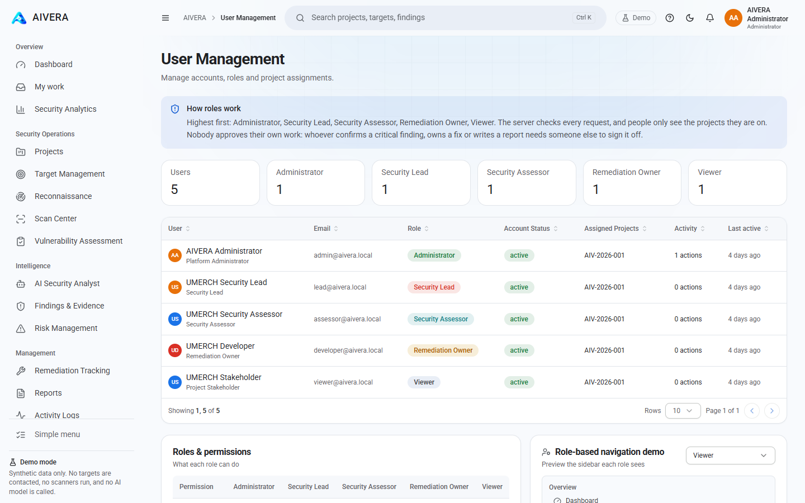</a><br><strong>15 · User Management</strong><br><sub>Accounts and roles</sub></td>
    <td align="center" width="50%"><a href="docs/screenshots/role-tour-2026-11-16/administrator-16-integrations.png"></a><br><strong>16 · Integrations</strong><br><sub>Tool connection status</sub></td>
  </tr>
  <tr>
    <td align="center" width="50%"><a href="docs/screenshots/role-tour-2026-11-16/administrator-17-settings.png">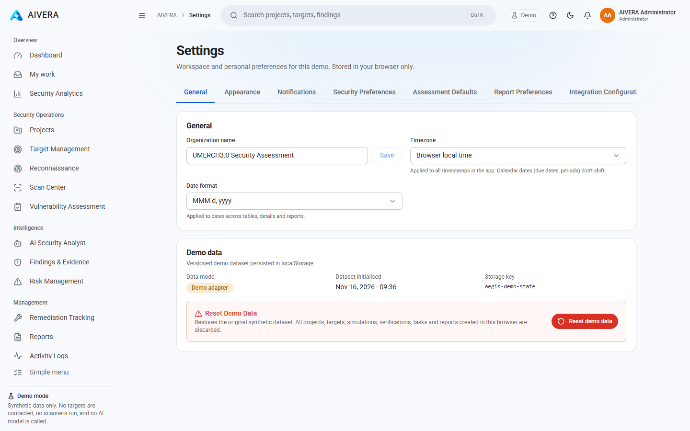</a><br><strong>17 · Settings</strong><br><sub>App preferences</sub></td>
  </tr>
</table>

### Security Lead

Leads coordinate reviews, approvals, and final reports.

<table>
  <tr>
    <td align="center" width="50%"><a href="docs/screenshots/role-tour-2026-11-16/lead-01-dashboard.png">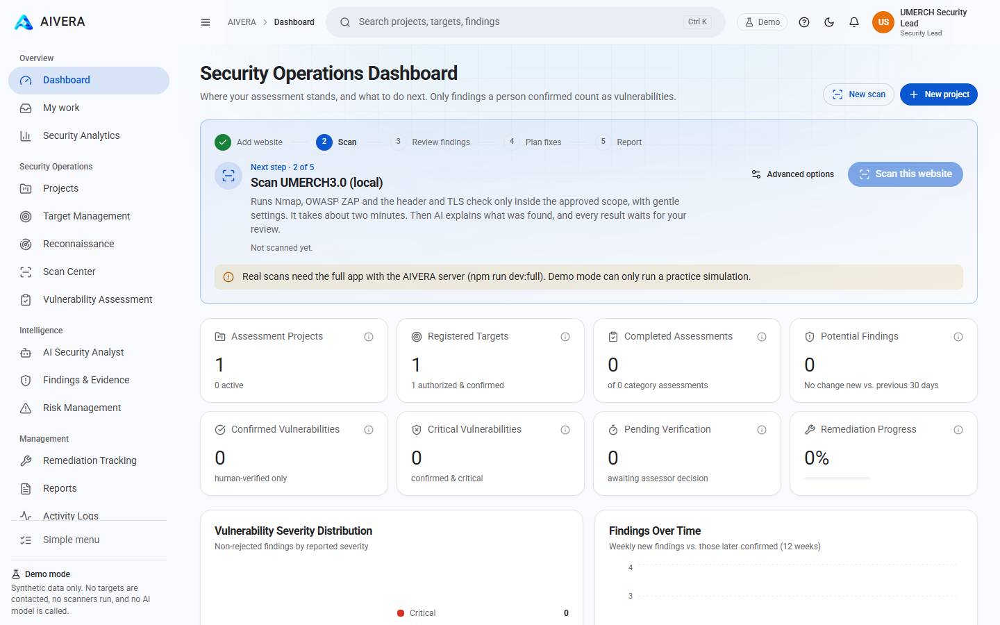</a><br><strong>1 · Dashboard</strong><br><sub>Review and approval overview</sub></td>
    <td align="center" width="50%"><a href="docs/screenshots/role-tour-2026-11-16/lead-02-my-work.png">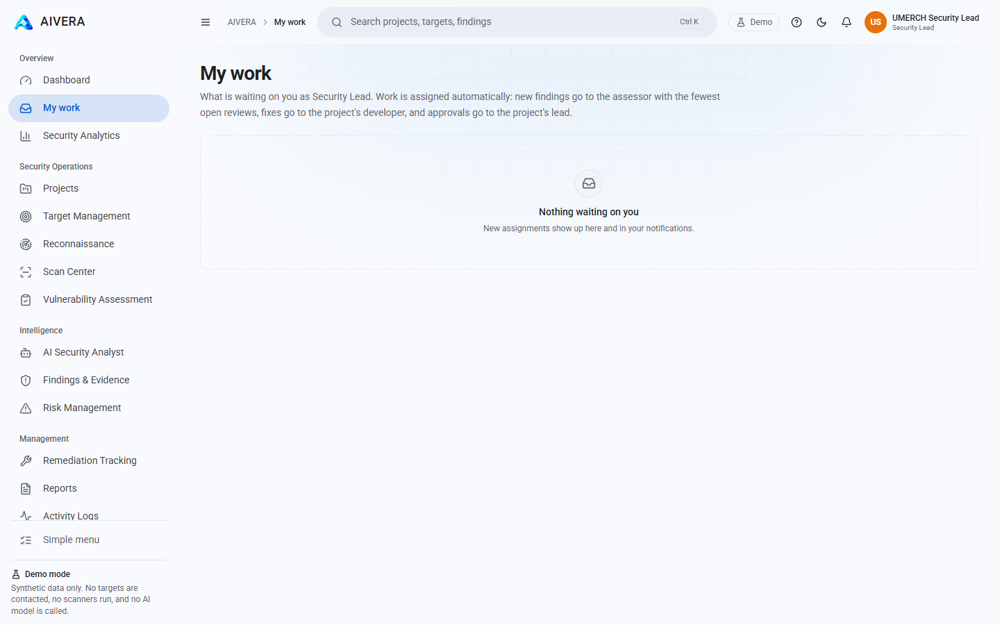</a><br><strong>2 · My work</strong><br><sub>Work and activity overview</sub></td>
  </tr>
  <tr>
    <td align="center" width="50%"><a href="docs/screenshots/role-tour-2026-11-16/lead-03-security-analytics.png"></a><br><strong>3 · Security Analytics</strong><br><sub>Assessment trends and metrics</sub></td>
    <td align="center" width="50%"><a href="docs/screenshots/role-tour-2026-11-16/lead-04-projects.png">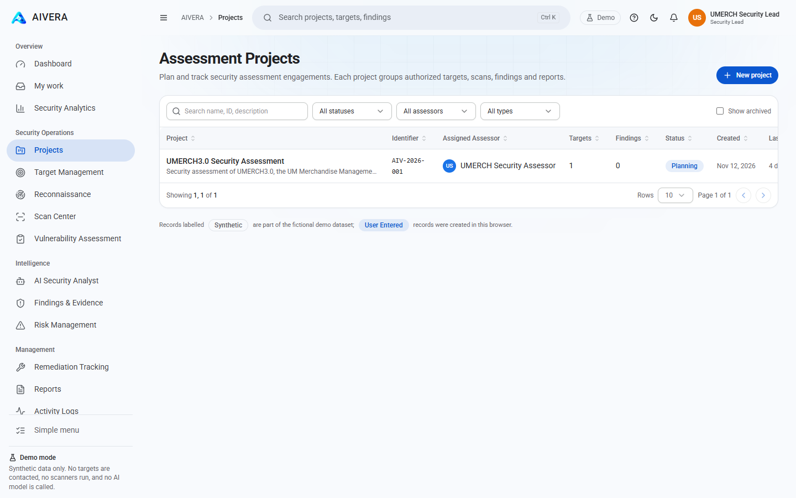</a><br><strong>4 · Projects</strong><br><sub>Assessment projects</sub></td>
  </tr>
  <tr>
    <td align="center" width="50%"><a href="docs/screenshots/role-tour-2026-11-16/lead-05-target-management.png">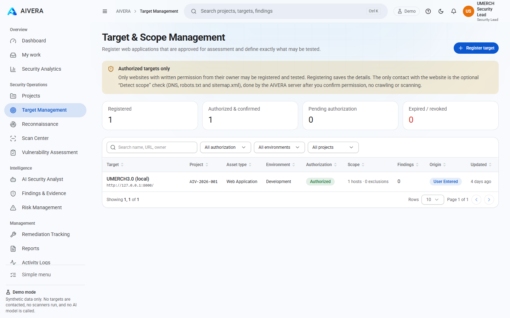</a><br><strong>5 · Target Management</strong><br><sub>Authorized targets and scope</sub></td>
    <td align="center" width="50%"><a href="docs/screenshots/role-tour-2026-11-16/lead-06-reconnaissance.png">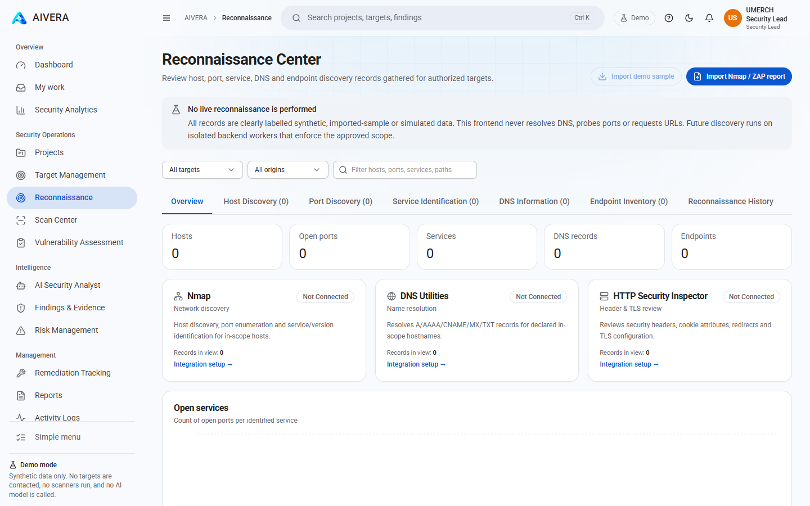</a><br><strong>6 · Reconnaissance</strong><br><sub>Hosts, services, and endpoints</sub></td>
  </tr>
  <tr>
    <td align="center" width="50%"><a href="docs/screenshots/role-tour-2026-11-16/lead-07-scan-center.png">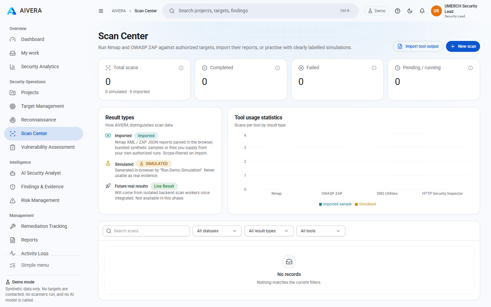</a><br><strong>7 · Scan Center</strong><br><sub>Scan status and history</sub></td>
    <td align="center" width="50%"><a href="docs/screenshots/role-tour-2026-11-16/lead-08-vulnerability-assessment.png"></a><br><strong>8 · Vulnerability Assessment</strong><br><sub>Guided security checks</sub></td>
  </tr>
  <tr>
    <td align="center" width="50%"><a href="docs/screenshots/role-tour-2026-11-16/lead-09-ai-security-analyst.png">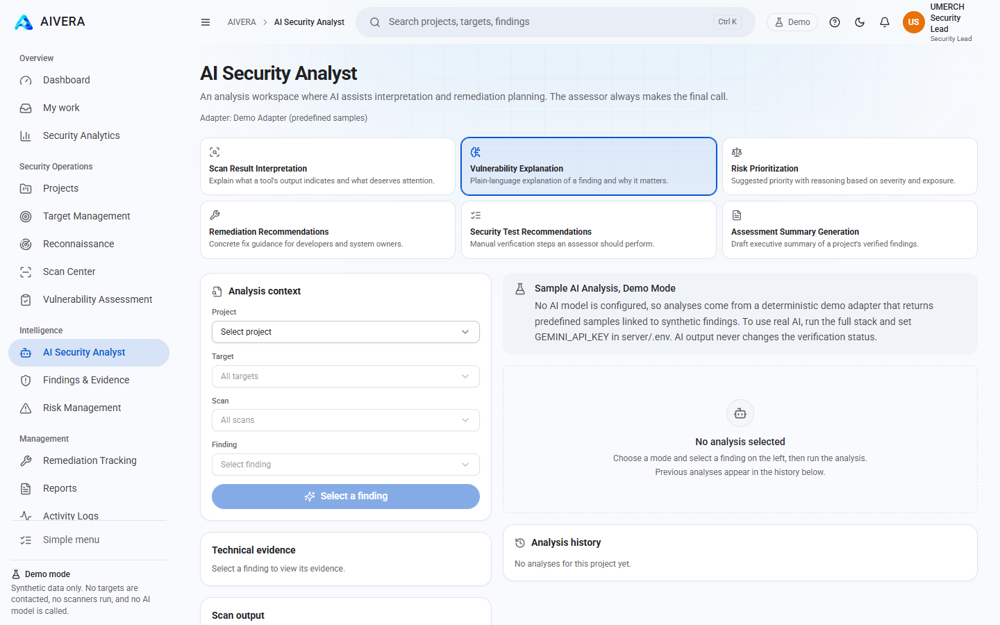</a><br><strong>9 · AI Security Analyst</strong><br><sub>AI-assisted evidence review</sub></td>
    <td align="center" width="50%"><a href="docs/screenshots/role-tour-2026-11-16/lead-10-findings-evidence.png">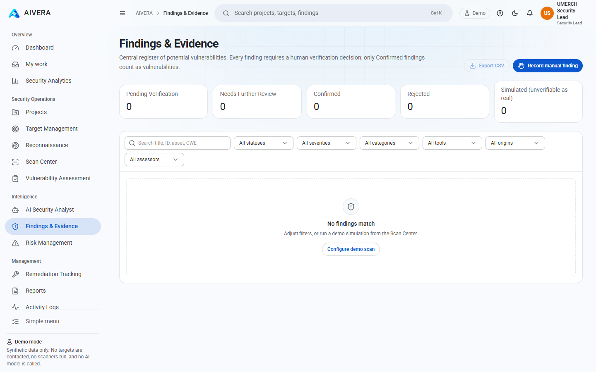</a><br><strong>10 · Findings &amp; Evidence</strong><br><sub>Findings and supporting proof</sub></td>
  </tr>
  <tr>
    <td align="center" width="50%"><a href="docs/screenshots/role-tour-2026-11-16/lead-11-risk-management.png">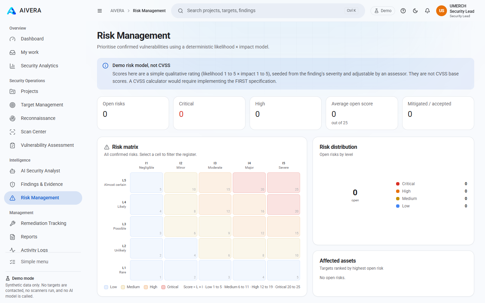</a><br><strong>11 · Risk Management</strong><br><sub>Risk register and priorities</sub></td>
    <td align="center" width="50%"><a href="docs/screenshots/role-tour-2026-11-16/lead-12-remediation-tracking.png">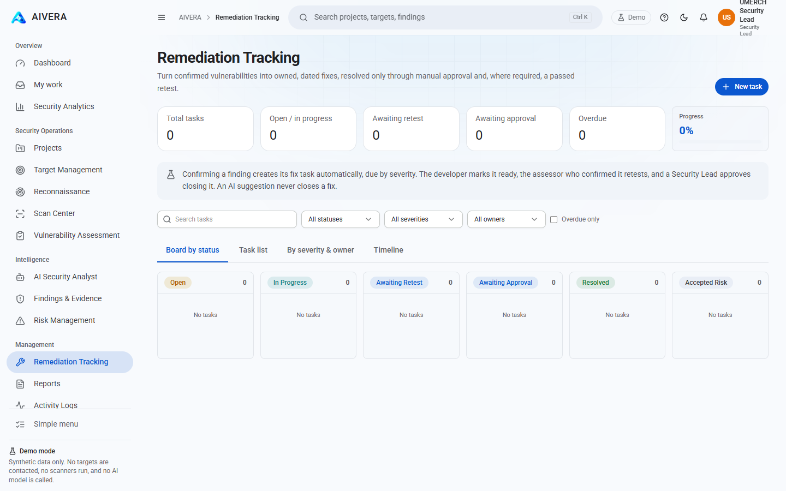</a><br><strong>12 · Remediation Tracking</strong><br><sub>Fixes and retest progress</sub></td>
  </tr>
  <tr>
    <td align="center" width="50%"><a href="docs/screenshots/role-tour-2026-11-16/lead-13-reports.png">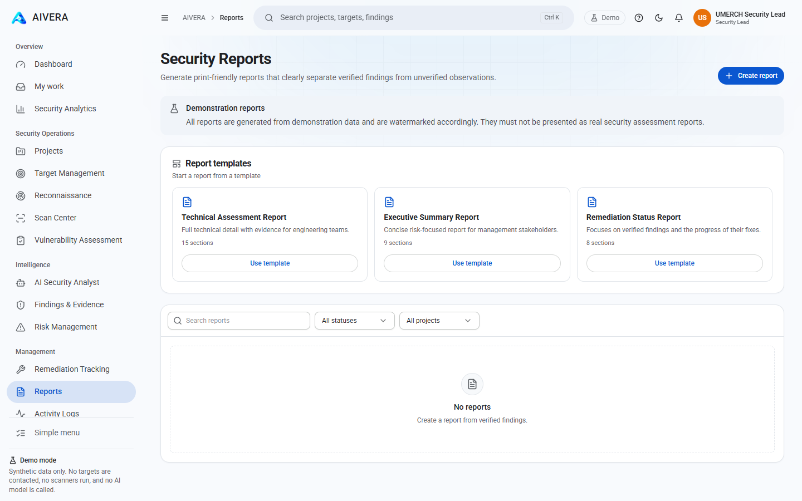</a><br><strong>13 · Reports</strong><br><sub>Assessment reports</sub></td>
    <td align="center" width="50%"><a href="docs/screenshots/role-tour-2026-11-16/lead-14-activity-logs.png">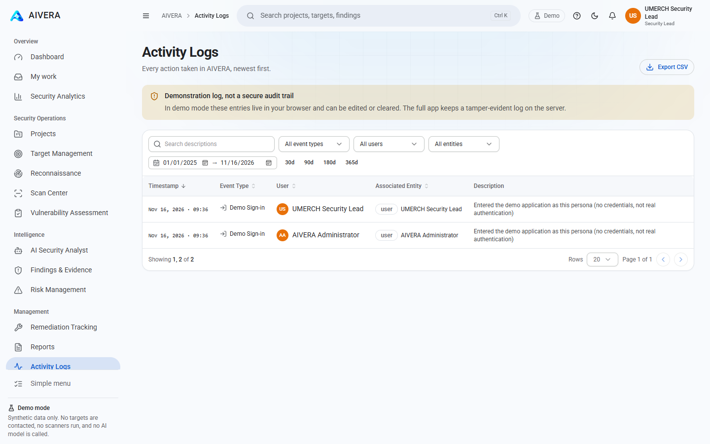</a><br><strong>14 · Activity Logs</strong><br><sub>Recorded activity</sub></td>
  </tr>
  <tr>
    <td align="center" width="50%"><a href="docs/screenshots/role-tour-2026-11-16/lead-15-integrations.png">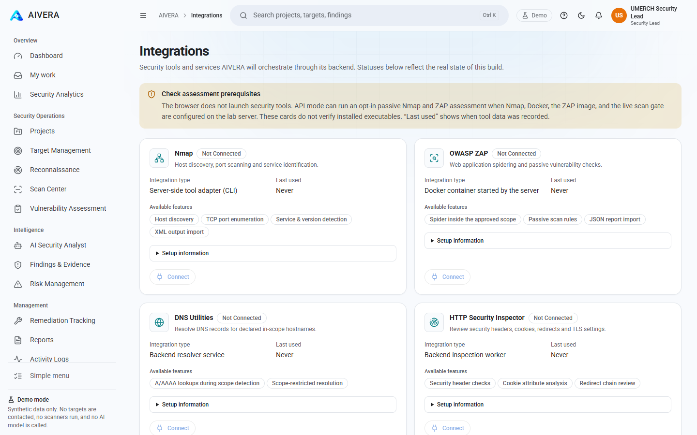</a><br><strong>15 · Integrations</strong><br><sub>Tool connection status</sub></td>
    <td align="center" width="50%"><a href="docs/screenshots/role-tour-2026-11-16/lead-16-settings.png">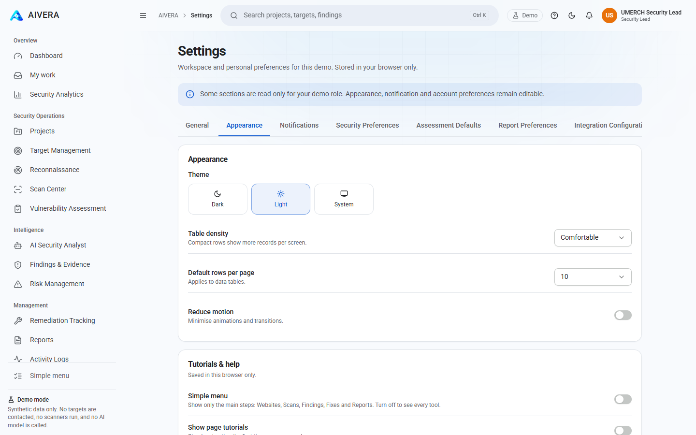</a><br><strong>16 · Settings</strong><br><sub>App preferences</sub></td>
  </tr>
</table>

### Security Assessor

Assessors run authorized tests and verify findings against evidence.

<table>
  <tr>
    <td align="center" width="50%"><a href="docs/screenshots/role-tour-2026-11-16/assessor-01-dashboard.png">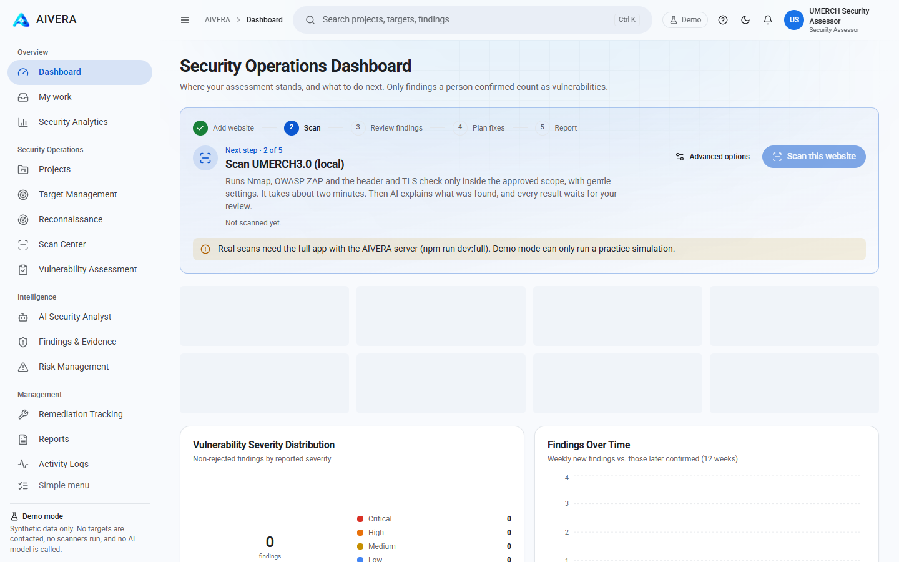</a><br><strong>1 · Dashboard</strong><br><sub>Assessment overview</sub></td>
    <td align="center" width="50%"><a href="docs/screenshots/role-tour-2026-11-16/assessor-02-my-work.png">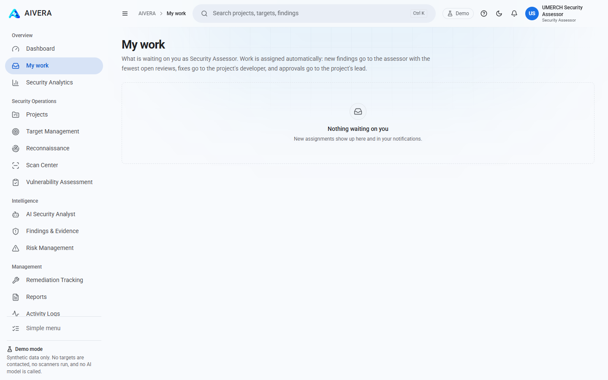</a><br><strong>2 · My work</strong><br><sub>Work and activity overview</sub></td>
  </tr>
  <tr>
    <td align="center" width="50%"><a href="docs/screenshots/role-tour-2026-11-16/assessor-03-security-analytics.png">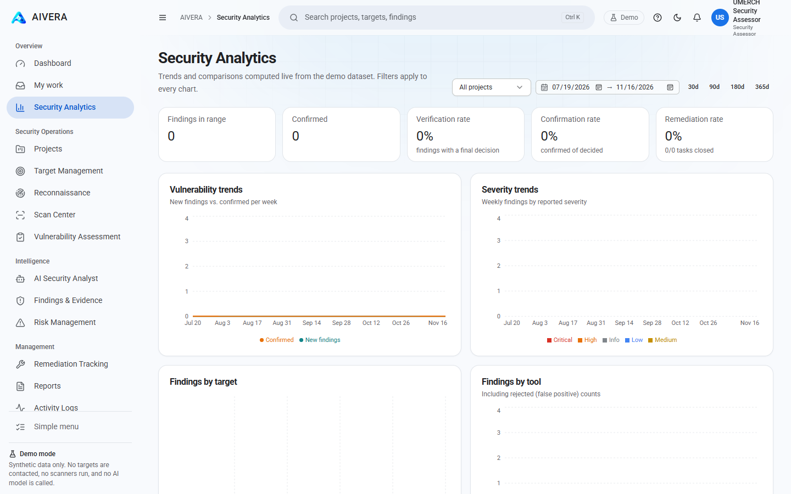</a><br><strong>3 · Security Analytics</strong><br><sub>Assessment trends and metrics</sub></td>
    <td align="center" width="50%"><a href="docs/screenshots/role-tour-2026-11-16/assessor-04-projects.png">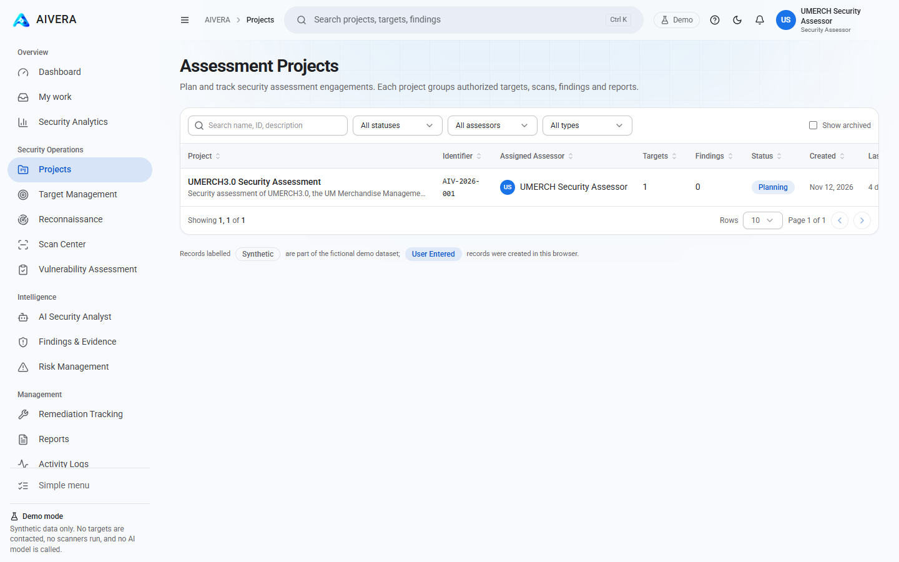</a><br><strong>4 · Projects</strong><br><sub>Assessment projects</sub></td>
  </tr>
  <tr>
    <td align="center" width="50%"><a href="docs/screenshots/role-tour-2026-11-16/assessor-05-target-management.png">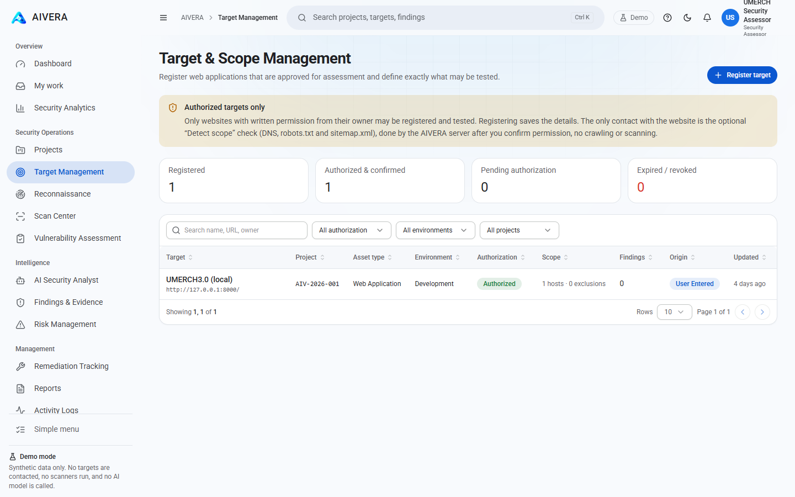</a><br><strong>5 · Target Management</strong><br><sub>Authorized targets and scope</sub></td>
    <td align="center" width="50%"><a href="docs/screenshots/role-tour-2026-11-16/assessor-06-reconnaissance.png">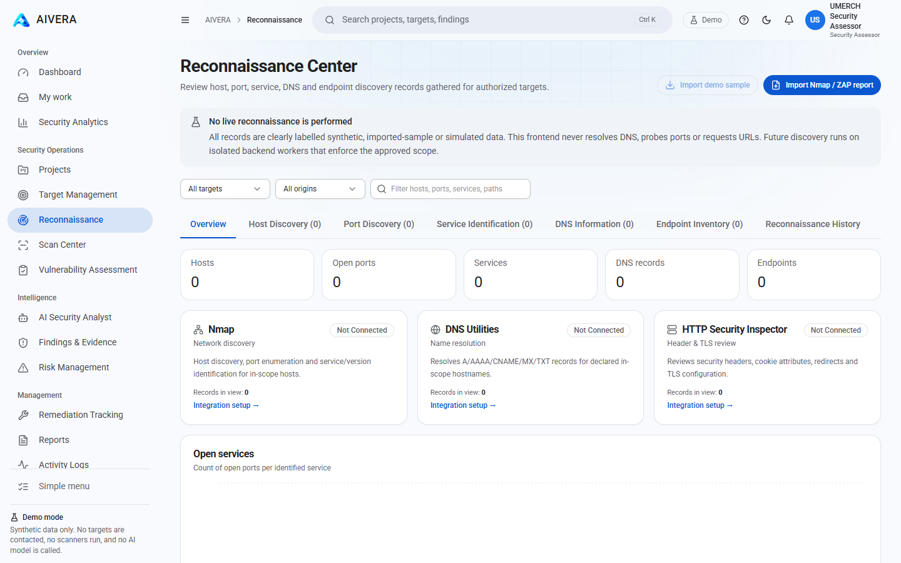</a><br><strong>6 · Reconnaissance</strong><br><sub>Hosts, services, and endpoints</sub></td>
  </tr>
  <tr>
    <td align="center" width="50%"><a href="docs/screenshots/role-tour-2026-11-16/assessor-07-scan-center.png">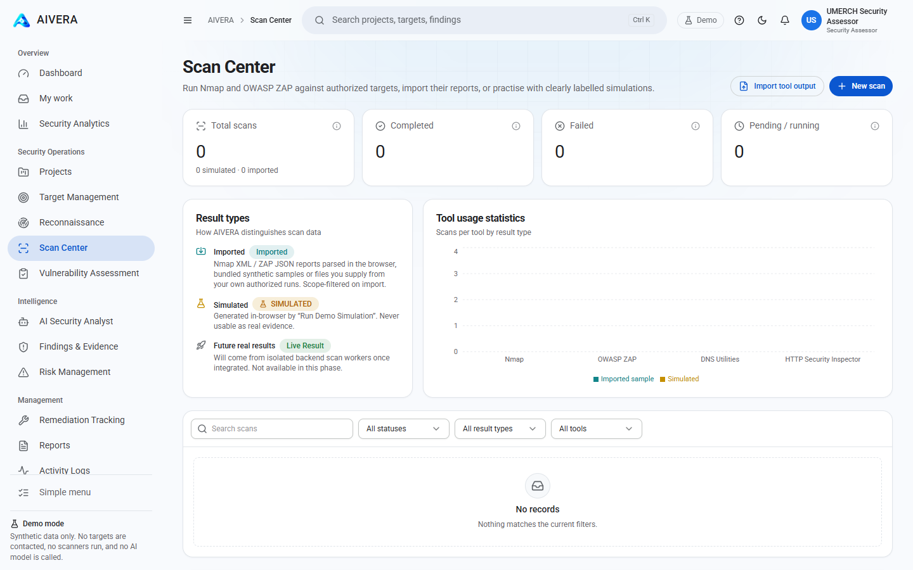</a><br><strong>7 · Scan Center</strong><br><sub>Scan status and history</sub></td>
    <td align="center" width="50%"><a href="docs/screenshots/role-tour-2026-11-16/assessor-08-vulnerability-assessment.png">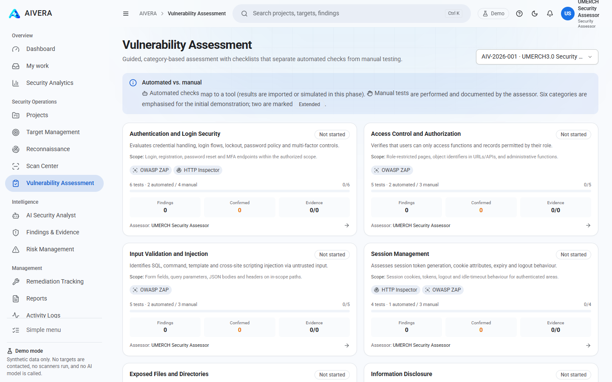</a><br><strong>8 · Vulnerability Assessment</strong><br><sub>Guided security checks</sub></td>
  </tr>
  <tr>
    <td align="center" width="50%"><a href="docs/screenshots/role-tour-2026-11-16/assessor-09-ai-security-analyst.png">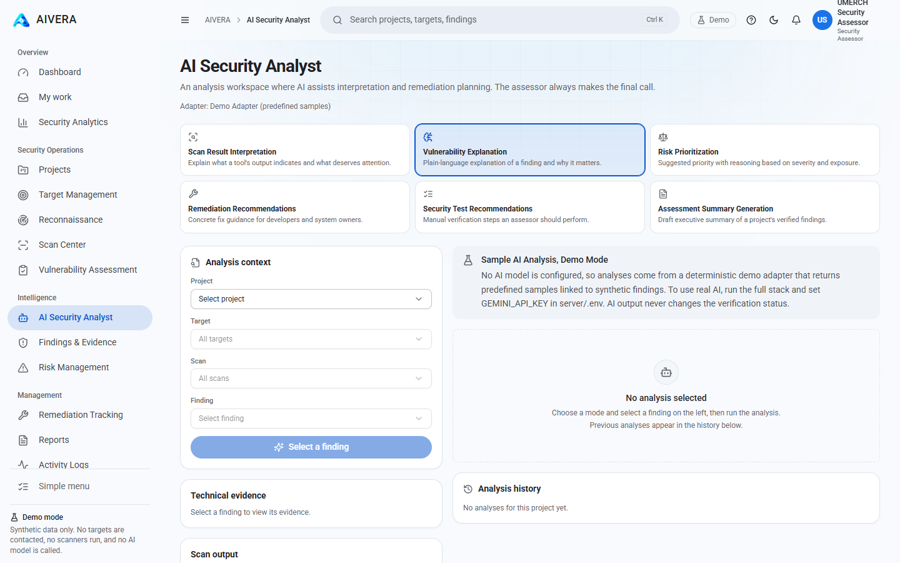</a><br><strong>9 · AI Security Analyst</strong><br><sub>AI-assisted evidence review</sub></td>
    <td align="center" width="50%"><a href="docs/screenshots/role-tour-2026-11-16/assessor-10-findings-evidence.png">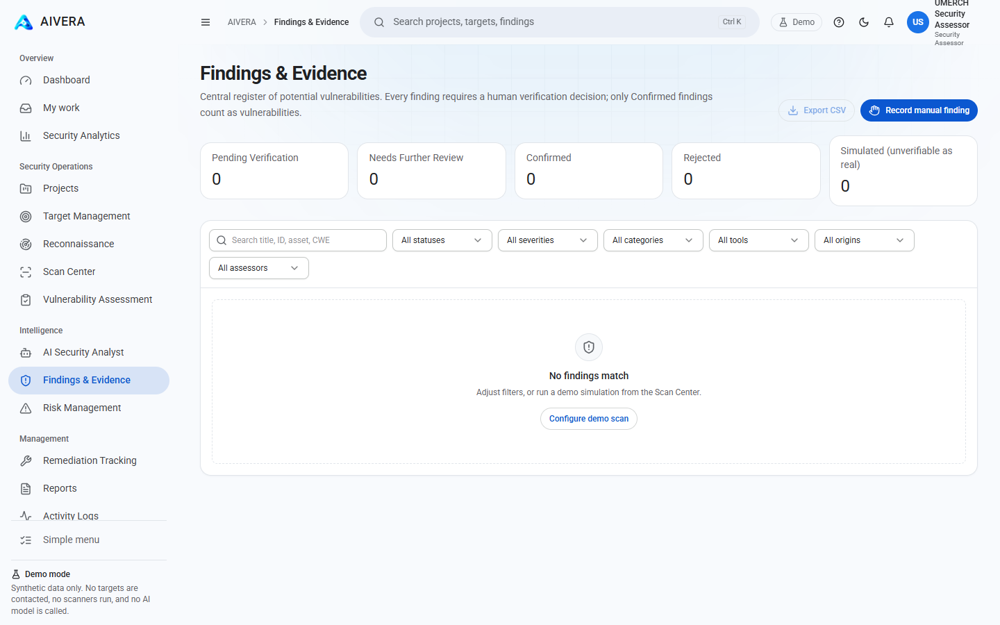</a><br><strong>10 · Findings &amp; Evidence</strong><br><sub>Findings and supporting proof</sub></td>
  </tr>
  <tr>
    <td align="center" width="50%"><a href="docs/screenshots/role-tour-2026-11-16/assessor-11-risk-management.png"></a><br><strong>11 · Risk Management</strong><br><sub>Risk register and priorities</sub></td>
    <td align="center" width="50%"><a href="docs/screenshots/role-tour-2026-11-16/assessor-12-remediation-tracking.png">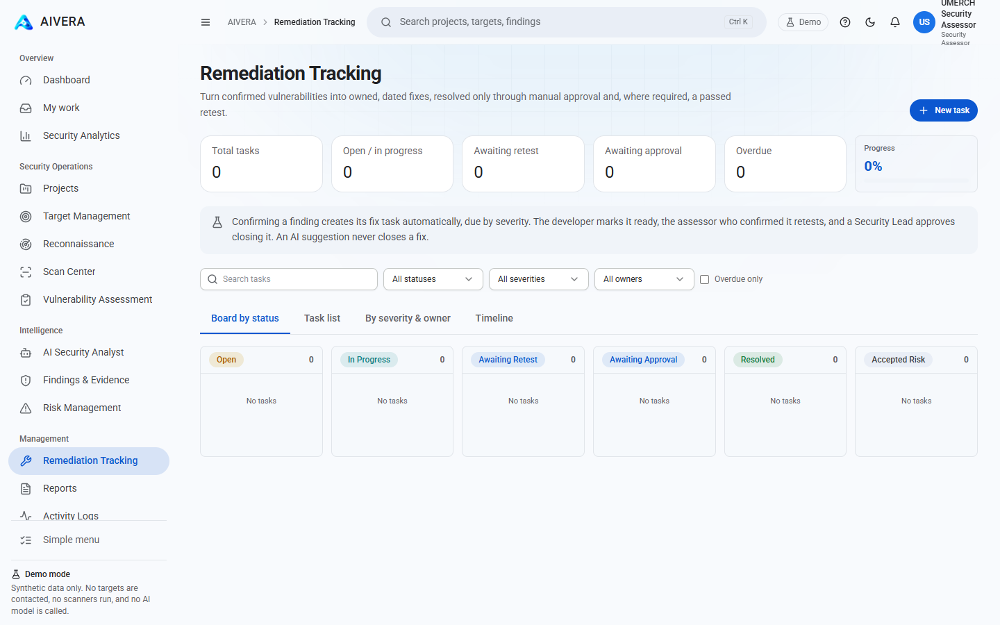</a><br><strong>12 · Remediation Tracking</strong><br><sub>Fixes and retest progress</sub></td>
  </tr>
  <tr>
    <td align="center" width="50%"><a href="docs/screenshots/role-tour-2026-11-16/assessor-13-reports.png">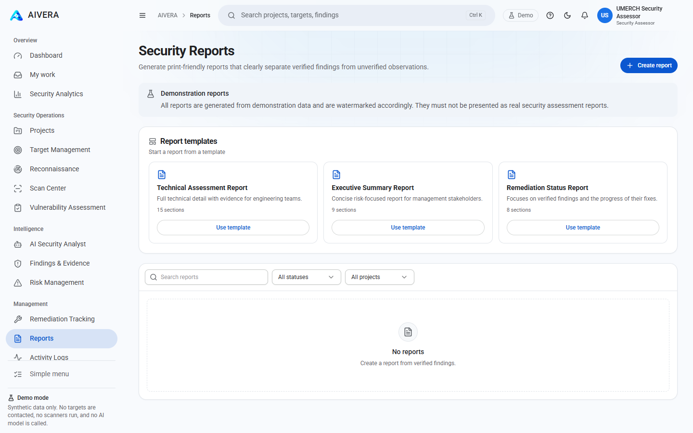</a><br><strong>13 · Reports</strong><br><sub>Assessment reports</sub></td>
    <td align="center" width="50%"><a href="docs/screenshots/role-tour-2026-11-16/assessor-14-activity-logs.png">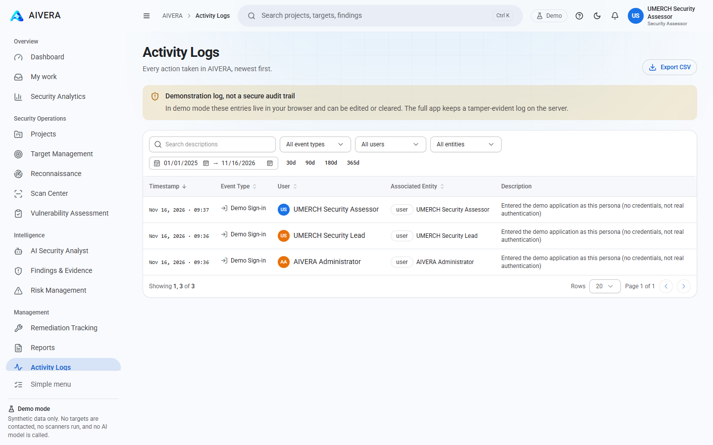</a><br><strong>14 · Activity Logs</strong><br><sub>Recorded activity</sub></td>
  </tr>
  <tr>
    <td align="center" width="50%"><a href="docs/screenshots/role-tour-2026-11-16/assessor-15-integrations.png">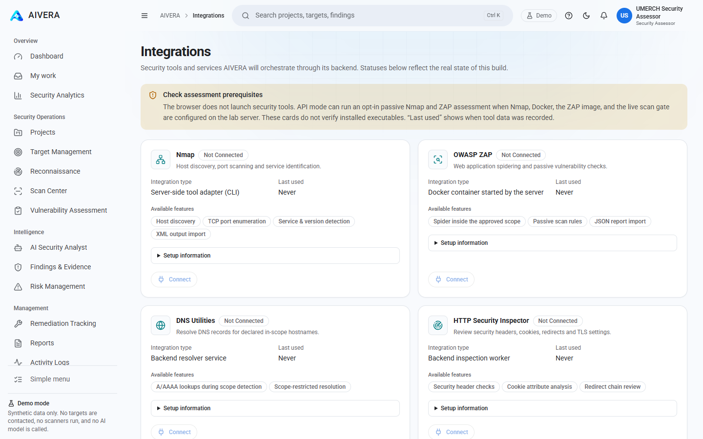</a><br><strong>15 · Integrations</strong><br><sub>Tool connection status</sub></td>
    <td align="center" width="50%"><a href="docs/screenshots/role-tour-2026-11-16/assessor-16-settings.png">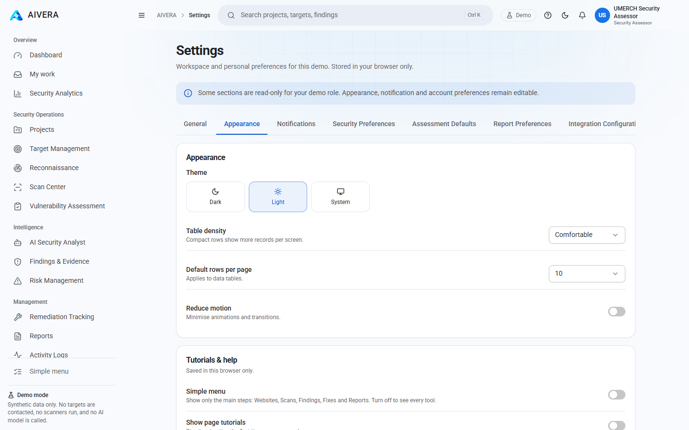</a><br><strong>16 · Settings</strong><br><sub>App preferences</sub></td>
  </tr>
</table>

### Remediation Owner

Fix owners track assigned work and request retests.

<table>
  <tr>
    <td align="center" width="50%"><a href="docs/screenshots/role-tour-2026-11-16/remediation-owner-01-dashboard.png">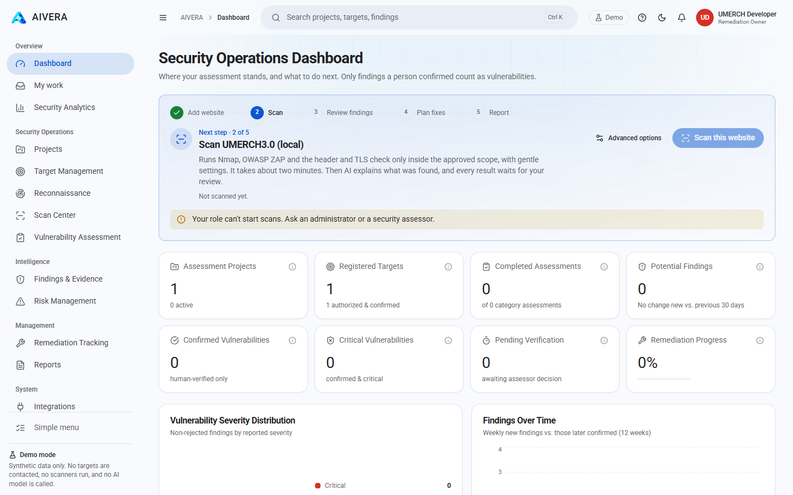</a><br><strong>1 · Dashboard</strong><br><sub>Assigned fixes overview</sub></td>
    <td align="center" width="50%"><a href="docs/screenshots/role-tour-2026-11-16/remediation-owner-02-my-work.png">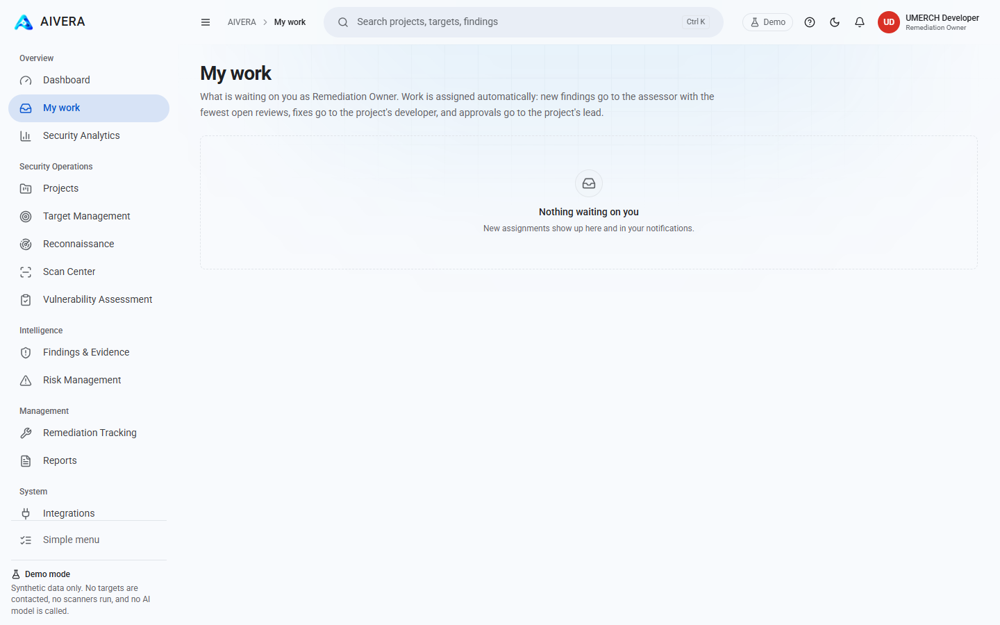</a><br><strong>2 · My work</strong><br><sub>Work and activity overview</sub></td>
  </tr>
  <tr>
    <td align="center" width="50%"><a href="docs/screenshots/role-tour-2026-11-16/remediation-owner-03-security-analytics.png"></a><br><strong>3 · Security Analytics</strong><br><sub>Assessment trends and metrics</sub></td>
    <td align="center" width="50%"><a href="docs/screenshots/role-tour-2026-11-16/remediation-owner-04-projects.png">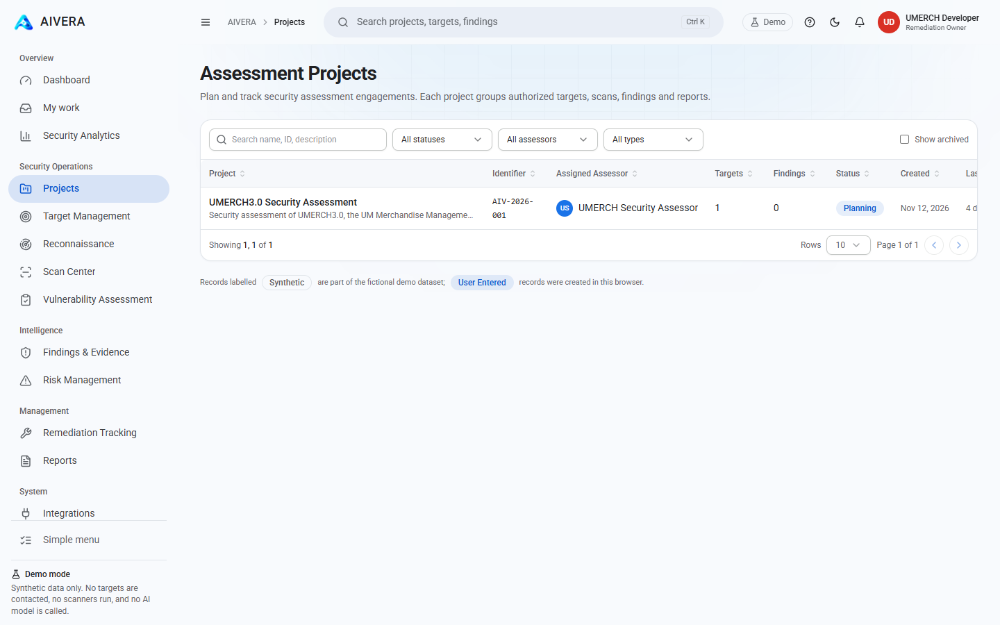</a><br><strong>4 · Projects</strong><br><sub>Assessment projects</sub></td>
  </tr>
  <tr>
    <td align="center" width="50%"><a href="docs/screenshots/role-tour-2026-11-16/remediation-owner-05-target-management.png">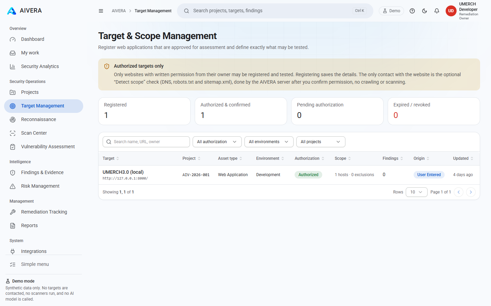</a><br><strong>5 · Target Management</strong><br><sub>Authorized targets and scope</sub></td>
    <td align="center" width="50%"><a href="docs/screenshots/role-tour-2026-11-16/remediation-owner-06-reconnaissance.png">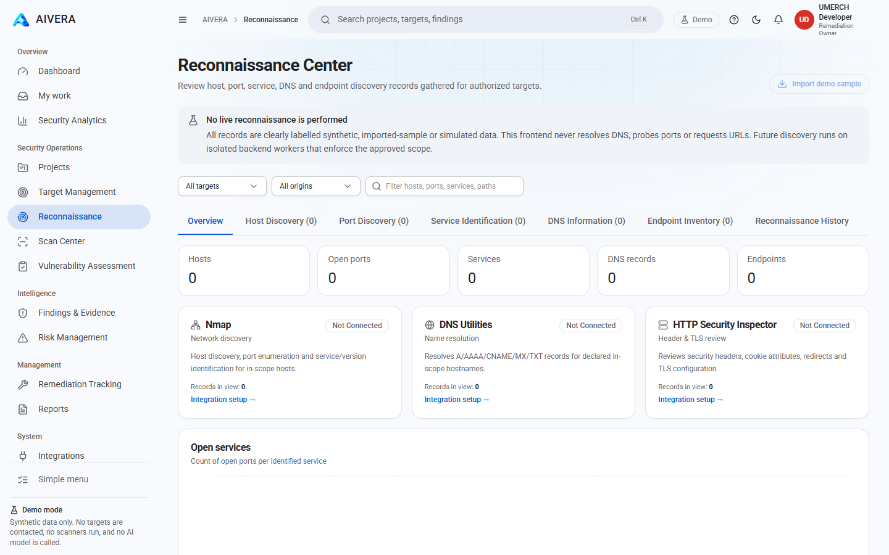</a><br><strong>6 · Reconnaissance</strong><br><sub>Hosts, services, and endpoints</sub></td>
  </tr>
  <tr>
    <td align="center" width="50%"><a href="docs/screenshots/role-tour-2026-11-16/remediation-owner-07-scan-center.png">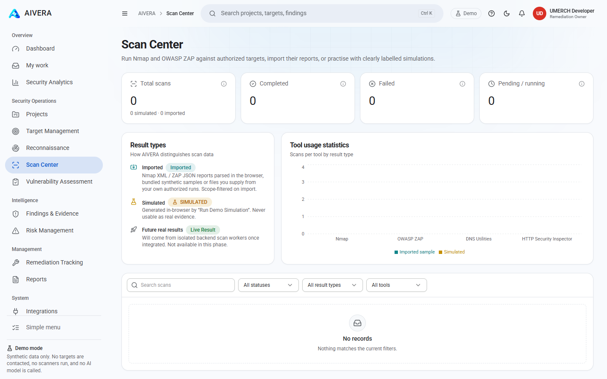</a><br><strong>7 · Scan Center</strong><br><sub>Scan status and history</sub></td>
    <td align="center" width="50%"><a href="docs/screenshots/role-tour-2026-11-16/remediation-owner-08-vulnerability-assessment.png"></a><br><strong>8 · Vulnerability Assessment</strong><br><sub>Guided security checks</sub></td>
  </tr>
  <tr>
    <td align="center" width="50%"><a href="docs/screenshots/role-tour-2026-11-16/remediation-owner-09-findings-evidence.png"></a><br><strong>9 · Findings &amp; Evidence</strong><br><sub>Findings and supporting proof</sub></td>
    <td align="center" width="50%"><a href="docs/screenshots/role-tour-2026-11-16/remediation-owner-10-risk-management.png"></a><br><strong>10 · Risk Management</strong><br><sub>Risk register and priorities</sub></td>
  </tr>
  <tr>
    <td align="center" width="50%"><a href="docs/screenshots/role-tour-2026-11-16/remediation-owner-11-remediation-tracking.png"></a><br><strong>11 · Remediation Tracking</strong><br><sub>Fixes and retest progress</sub></td>
    <td align="center" width="50%"><a href="docs/screenshots/role-tour-2026-11-16/remediation-owner-12-reports.png"></a><br><strong>12 · Reports</strong><br><sub>Assessment reports</sub></td>
  </tr>
  <tr>
    <td align="center" width="50%"><a href="docs/screenshots/role-tour-2026-11-16/remediation-owner-13-integrations.png"></a><br><strong>13 · Integrations</strong><br><sub>Tool connection status</sub></td>
    <td align="center" width="50%"><a href="docs/screenshots/role-tour-2026-11-16/remediation-owner-14-settings.png"></a><br><strong>14 · Settings</strong><br><sub>App preferences</sub></td>
  </tr>
</table>

### Viewer

Viewers follow project status and read available results.

<table>
  <tr>
    <td align="center" width="50%"><a href="docs/screenshots/role-tour-2026-11-16/viewer-01-dashboard.png"></a><br><strong>1 · Dashboard</strong><br><sub>Read-only project overview</sub></td>
    <td align="center" width="50%"><a href="docs/screenshots/role-tour-2026-11-16/viewer-02-my-work.png"></a><br><strong>2 · My work</strong><br><sub>Work and activity overview</sub></td>
  </tr>
  <tr>
    <td align="center" width="50%"><a href="docs/screenshots/role-tour-2026-11-16/viewer-03-security-analytics.png"></a><br><strong>3 · Security Analytics</strong><br><sub>Assessment trends and metrics</sub></td>
    <td align="center" width="50%"><a href="docs/screenshots/role-tour-2026-11-16/viewer-04-projects.png"></a><br><strong>4 · Projects</strong><br><sub>Assessment projects</sub></td>
  </tr>
  <tr>
    <td align="center" width="50%"><a href="docs/screenshots/role-tour-2026-11-16/viewer-05-target-management.png"></a><br><strong>5 · Target Management</strong><br><sub>Authorized targets and scope</sub></td>
    <td align="center" width="50%"><a href="docs/screenshots/role-tour-2026-11-16/viewer-06-reconnaissance.png"></a><br><strong>6 · Reconnaissance</strong><br><sub>Hosts, services, and endpoints</sub></td>
  </tr>
  <tr>
    <td align="center" width="50%"><a href="docs/screenshots/role-tour-2026-11-16/viewer-07-scan-center.png"></a><br><strong>7 · Scan Center</strong><br><sub>Scan status and history</sub></td>
    <td align="center" width="50%"><a href="docs/screenshots/role-tour-2026-11-16/viewer-08-vulnerability-assessment.png"></a><br><strong>8 · Vulnerability Assessment</strong><br><sub>Guided security checks</sub></td>
  </tr>
  <tr>
    <td align="center" width="50%"><a href="docs/screenshots/role-tour-2026-11-16/viewer-09-findings-evidence.png"></a><br><strong>9 · Findings &amp; Evidence</strong><br><sub>Findings and supporting proof</sub></td>
    <td align="center" width="50%"><a href="docs/screenshots/role-tour-2026-11-16/viewer-10-risk-management.png"></a><br><strong>10 · Risk Management</strong><br><sub>Risk register and priorities</sub></td>
  </tr>
  <tr>
    <td align="center" width="50%"><a href="docs/screenshots/role-tour-2026-11-16/viewer-11-remediation-tracking.png"></a><br><strong>11 · Remediation Tracking</strong><br><sub>Fixes and retest progress</sub></td>
    <td align="center" width="50%"><a href="docs/screenshots/role-tour-2026-11-16/viewer-12-reports.png"></a><br><strong>12 · Reports</strong><br><sub>Assessment reports</sub></td>
  </tr>
  <tr>
    <td align="center" width="50%"><a href="docs/screenshots/role-tour-2026-11-16/viewer-13-integrations.png"></a><br><strong>13 · Integrations</strong><br><sub>Tool connection status</sub></td>
    <td align="center" width="50%"><a href="docs/screenshots/role-tour-2026-11-16/viewer-14-settings.png"></a><br><strong>14 · Settings</strong><br><sub>App preferences</sub></td>
  </tr>
</table>

## Roles

| Role | Main work |
| --- | --- |
| **Administrator** | Manage access, settings, projects, assessments, and system oversight |
| **Security Lead** | Coordinate assessments and approve high-impact findings, fixes, and final reports |
| **Security Assessor** | Run authorized assessments, review evidence, verify findings, and draft reports |
| **Remediation Owner** | Work assigned fixes and request retests |
| **Viewer** | Read project status and available results |

## How it works

Each assessment passes work between the five roles. The branches show what happens when an assessor rejects a finding, when a fix fails retesting, and when a critical or high finding needs lead sign-off.


- **Administrator → team:** Activates accounts, controls roles and settings, and can oversee any project. The administrator makes it possible for the assigned team to work together.
- **Security Lead → Security Assessor:** Sets up the project team and checks that a target is authorized before testing. The lead also signs off critical and high findings after an assessor confirms them.
- **Security Assessor → decision:** Runs authorized checks or imports tool output, reviews evidence, and confirms or rejects each finding. A rejection is logged without creating a fix task. A confirmation creates a risk record and a task for the remediation owner. AI can help interpret evidence but cannot verify a finding.
- **Remediation Owner → Security Assessor:** Works the assigned fix and marks it ready for retest. If the retest fails, the task returns to the owner for more work.
- **Security Assessor → Security Lead:** Records retest results and drafts the assessment report when all findings have been reviewed. Reporting can proceed while fix tasks continue. A passed retest goes to the lead for closure approval; the lead also approves the final report. Critical and high confirmed findings need a separate lead sign-off.
- **Security Lead → Viewer:** Makes approved results available. Viewers can follow project status during the work and read approved reports, but cannot change the assessment.

Dashed paths show the additional lead sign-off and updates to the viewer. A failed retest loops back to the fix owner; a rejected finding creates no fix task and is excluded from verified report findings. Administrators can step in throughout, and viewers can follow status while work progresses. The browser demo uses synthetic local data; API mode enforces roles and scope on the server and stores records in SQLite. See the [system design](docs/System-Design.md) for the full workflow.

## Run locally

You need **Node.js 22 or newer** and npm. SQLite is bundled through the app dependencies. For the full API mode, set a password of your choice as `SEED_DEMO_PASSWORD` in `server/.env` before seeding a **fresh development database**:

```powershell
npm install
Copy-Item server/.env.example server/.env
# Set SEED_DEMO_PASSWORD in server/.env
npm run db:setup
npm run dev:full
```

Open **http://localhost:5173**. Sign in as `admin@aivera.local` with the password you set. The API runs at `http://localhost:4000/api`. `db:setup` seeds starting data, so use the [setup guide](docs/SETUP.md) before running it against an existing database.

To explore the synthetic browser demo without an API or database:

```powershell
npm install
npm run dev:demo
```

Nmap, ZAP, and AI credentials are optional for local setup. Live assessments require separate configuration and authorization; follow the [setup guide](docs/SETUP.md#7-live-scanning) and [authorized target lab plan](docs/Authorized-Target-Lab.md).

## Security and validation

API mode checks role permissions and target scope on assessment actions, requires a human decision on findings, and records supported actions in a tamper-evident activity log. Browser demo records and scans are labelled synthetic or simulated. The [project guide](docs/PROJECT_GUIDE.md) describes the controls and current limits in detail.

| Command | Purpose |
| --- | --- |
| `npm run typecheck` | Check frontend and server TypeScript |
| `npm run test:scan-scope` | Test scan scope and safety rules |
| `npm run test:e2e` | Test the persisted workflow |
| `npm run build:api` | Build the API-mode frontend |

## Explore the repository

| Area | Start here | What you will find |
| --- | --- | --- |
| App routes | [src/app/router.tsx](src/app/router.tsx) | Public and role-aware pages |
| UI screens | [src/pages/](src/pages/) | Projects, scans, findings, remediation, and reports |
| Demo state | [src/stores/](src/stores/) | Synthetic data and browser persistence |
| API | [server/src/routes/](server/src/routes/) | Authentication, workflow, and assessment endpoints |
| Database | [server/prisma/](server/prisma/) | Prisma schema and migrations |
| Screenshots | [capture archive](docs/screenshots/role-tour-2026-11-16/README.md) | Every image shown above |
| Setup | [docs/SETUP.md](docs/SETUP.md) | Configuration and operating guide |
| Design | [docs/System-Design.md](docs/System-Design.md) | Architecture and finding lifecycle |
| Detailed notes | [docs/PROJECT_GUIDE.md](docs/PROJECT_GUIDE.md) | Module status, demo walk-through, and implementation limits |
