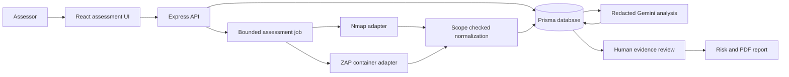
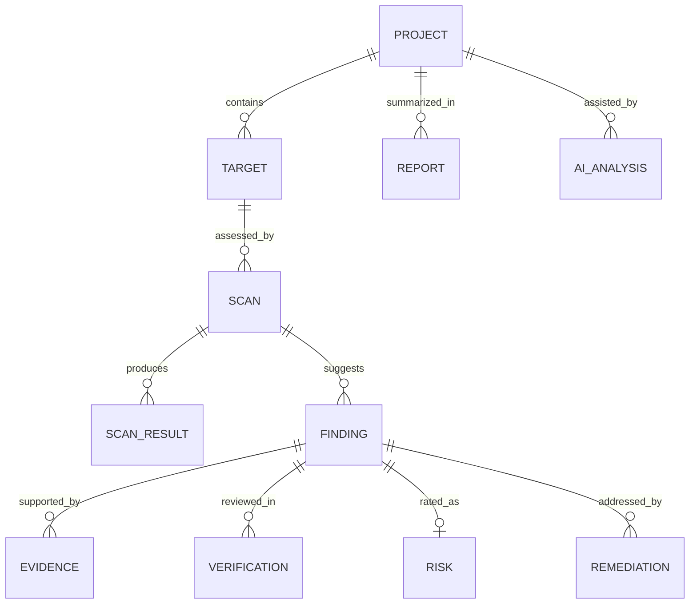
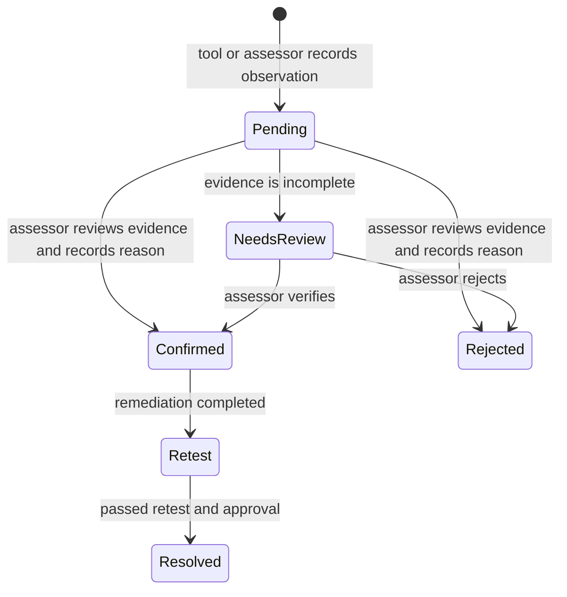

# AIVERA System Design and Assessment Workflow

## Architecture

The UI supplies one approved target and configuration. The API checks the user's role, the target's authorization state, the exact host, the approved categories, and the passive scan profile before accepting a job. Each adapter runs a bounded external tool with fixed arguments. The ZAP plan derives its context and URL patterns from the stored target scope. Outputs pass through the existing Nmap XML and ZAP JSON parsers and import normalization. Every resulting finding starts pending. Gemini's redacted analysis is advisory; only the verification route changes a finding to confirmed. The report model excludes unverified findings from its verified section and labels simulated or imported material by origin.

## Data model

The Prisma schema stores Projects, Targets and scope, Scans, ScanResults, Hosts, Ports, Endpoints, Findings, Evidence, Verifications, AIAnalyses, Risks, Remediation tasks, Reports, and ActivityLogs. IDs connect observations back to their scan and target. `dataOrigin` distinguishes simulated, imported, user-created, and live records. The final documentation should include an exported entity relationship diagram from `server/prisma/schema.prisma` and explain the key relations and indexes.

The diagram shows the logical relationships used by IDs in the application. The Prisma file is the authoritative physical schema; several references are stored as string IDs rather than declared database foreign keys, so the API must validate cross-record consistency.

## Finding lifecycle

## Adapter contract and extension

The automated web runner returns a tool identifier, raw output, and a parsed result. To support another system, add an adapter that declares its supported target type, required scope fields, bounded execution method, and parser into the common evidence model. Do not present a generic host or API as supported until its adapter has been tested. The current implemented adapters are Nmap TCP service discovery and ZAP passive web scanning; DNS and HTTP inspection currently have demo paths and limited scope detection but are not live scan adapters.

## Methodology and safeguards

The assessment sequence follows planning and scope, reconnaissance, scanning, assessment, AI interpretation, human verification, risk assessment, and reporting. Use NIST SP 800-115 for the process and the OWASP WSTG for specific web tests. The first live profile is passive: ZAP spiders and performs passive analysis only; active payload testing requires a separately designed approval and rate-control path. Excluded paths take precedence. Record tool versions and the exact scope snapshot in the final report. Preventing redirects and DNS rebinding to out-of-scope networks requires further worker-level egress controls before shared deployment.

## Verification and completion criteria

For a final demonstration, show an approved local target, one complete live scan, raw output from two tools, three honestly assessed categories, at least two real AI functions, evidence-linked human decisions, a report generated from verified findings, and each member's contribution. A build and type check establish code health but do not prove live scan behavior or the accuracy of security findings.
